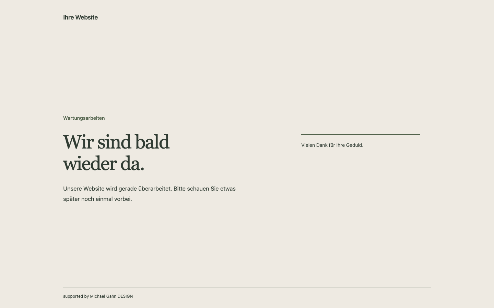

> **WordPress.org-Kandidat:** Dieser Branch verwendet native Verzeichnis-Updates. Paketbau, Prüfergebnisse und Wechselhinweise: [WordPress.org-Vorbereitung](docs/WORDPRESS-ORG.md). Die nachfolgende bisherige Dokumentation beschreibt auch die separate GitHub-Ausgabe.

<p align="center"></p>
<h1 align="center">MG Maintenance Studio</h1>
<p align="center"><strong>Eine gute Wartungsseite gehört zur Website.</strong><br>Gestalten, geschützt prüfen und bewusst veröffentlichen – direkt in WordPress.</p>
<p align="center"><a href="https://github.com/MichaelGahnDESIGN/MGD-Maintenance-WordPress/releases/latest">Plugin herunterladen</a> · <a href="https://github.com/MichaelGahnDESIGN/MGD-Maintenance-WordPress/wiki">Handbuch & Wiki</a> · <a href="SECURITY.md">Sicherheit</a> · <a href="CHANGELOG.md">Changelog</a></p>


**WordPress ab 6.5 · PHP ab 8.1 · Version 0.5.2 · Deutsch · GPL-2.0-or-later**

MG Maintenance Studio ersetzt die öffentliche Ansicht während Wartungsarbeiten durch eine eigene, anpassbare Seite. Besucher erhalten eine verständliche Mitteilung; berechtigte Personen können weiter an der Website arbeiten. Farben, Typografie, Logo, Kontaktmöglichkeiten und Rechtstexte werden im WordPress-Backend gepflegt.

Das Plugin kommt ohne Konto bei einem Drittanbieter, Lizenzschlüssel oder externe Schriftbibliotheken aus. GitHub-Updates sind optional und anfangs ausgeschaltet. Das öffentliche Repository heißt **MGD-Maintenance-WordPress**; der installierbare Pluginordner heißt **mg-maintenance-studio**.


*Beispiel aus der lokalen Testinstallation. Texte, Farben, Medien und Abstände lassen sich anpassen.*

## Schnellstart

1. Unter [Releases](https://github.com/MichaelGahnDESIGN/MGD-Maintenance-WordPress/releases/latest) die Datei **mg-maintenance-studio-0.5.2.zip** herunterladen. Für spätere Versionen das entsprechend benannte Plugin-ZIP verwenden, nicht „Source code“.
2. In WordPress **Plugins → Installieren → Plugin hochladen** öffnen, ZIP auswählen und das Plugin aktivieren. Die erste Aktivierung schaltet den Wartungsmodus noch **nicht** ein.
3. Unter **Maintenance Studio** Texte, Design und Zugangsregeln einrichten.
4. **Entwurf speichern**, dann die geschützte Vorschau öffnen und die Darstellung prüfen.
5. **Einstellungen veröffentlichen** ausdrücklich bestätigen. Anschließend den **Wartungsmodus aktivieren** separat bestätigen.
6. Die Website ausgeloggt oder in einem privaten Browserfenster aufrufen. Bei vorgeschaltetem Cache/CDN auch dort die neue Ausgabe prüfen.

Vor einer produktiven Installation zuerst auf einer Testwebsite prüfen und Dateien sowie Datenbank sichern. Es wurde keine bestimmte Kundenumgebung freigegeben.

## Was das Plugin mitbringt

| Bereich | Möglichkeiten |
|---|---|
| Gestaltung | Vier Vorlagen mit vier Seitenlayouts, Markenbereich als Text, Logo oder beides, sichtbare lokale Medienvorschauen, Farben, Systemschriften oder vorhandene lokale WOFF2-Dateien, Ausrichtung, Container und geräteabhängige Abstände |
| Inhalte | Marke, Überschrift, Beschreibung, Zusatzhinweise, Kontaktlinks und geplanter Rückkehrzeitpunkt |
| Vorschau | Administratorzugang, kurzlebiger Einmal-Token und unmittelbare Vorschau vieler Text- und Designänderungen |
| Veröffentlichung | Getrennter Entwurf, veröffentlichter Stand und Wartungsschalter; ein vorheriger Stand zur Wiederherstellung |
| Statusschalter | Sichtbar im Plugin-Backend und, wenn die Statusplakette aktiviert ist, auch auf der öffentlichen Website ausschließlich für Administratoren |
| Anmeldehinweise | Neutrale Fehlermeldung ohne Unterscheidung zwischen unbekanntem Konto und falschem Passwort; bei aktivem Plugin auch ohne eingeschaltete Wartungsseite |
| Zugänge | Separate Administrator-Ausnahme, Benutzer-/Rollenregeln, IPv4-/IPv6-Adressen und begrenzte CIDR-Netze |
| Rechtstexte | Bis zu fünf eigene Textblöcke, Footerlinks, Dialoge oder ausdrücklich freigegebene WordPress-Seiten |
| Fehlerseiten | Getrennte 404- und 403-Seiten mit drei Vorlagen, Texten, Farben, Entwurf und Vorschau |
| Suchmaschinen | HTTP 503 als Standard, Retry-After, noindex-Header und optional virtuelle robots.txt-Regeln |
| Updates | Öffentliche GitHub-Releases im normalen WordPress-Updateablauf, eigenes Icon und Plugin-Details |

## Drei Schritte, drei unterschiedliche Wirkungen

| Aktion | Wirkung auf Besucher |
|---|---|
| **Entwurf speichern** | Noch keine Änderung der veröffentlichten Wartungsseite |
| **Einstellungen veröffentlichen** | Neuer Stand wird bei bereits aktivem Wartungsmodus sofort sichtbar |
| **Wartungsmodus aktivieren/deaktivieren** | Schaltet zwischen Wartungsansicht und normaler Website um |

Ein Countdown ist nur eine Anzeige. Er beendet den Wartungsmodus nicht automatisch. Bei Deaktivierung des Plugins endet dessen Ausgabe; der gespeicherte Wartungsstatus bleibt erhalten. Eine spätere Reaktivierung kann deshalb die zuvor eingeschaltete Wartungsseite wieder anzeigen.

## Vier Vorlagen und vier Seitenlayouts

**Elegant Gold** verwendet eine großzügige redaktionelle Ansicht. **Minimalistisch Hell** zentriert die Mitteilung. **Ruhiges Atelier** teilt Text und Zusatzinformationen in zwei Bereiche. **Nachtstudio** stellt die Botschaft wie ein dunkles Poster dar. Jede Vorlage lässt sich mit Farben, Logo, Hintergrund und Abständen weiter gestalten.

Vorlagen ändern Designwerte im Formular. Eigene Texte und Freigaben bleiben erhalten. Bilder und Schriften müssen aus der lokalen Mediathek und vom selben Ursprung wie die Website stammen. Das Plugin schaltet keine zusätzlichen Upload-Dateitypen frei.

Viele Texte, Farben und Abstände werden direkt in der geöffneten Vorschau aktualisiert. Ein neu ausgewähltes Logo oder Hintergrundbild wird ebenfalls direkt angezeigt. Kontaktlinks, Countdown und Rechtstexte benötigen Speichern und erneutes Öffnen. [Mehr zur Gestaltung →](docs/wiki/Design-und-Vorschau.md)

## Updates über GitHub

Unter **Maintenance Studio → Updates** ist `MichaelGahnDESIGN/MGD-Maintenance-WordPress` vorbelegt. **GitHub-Prüfung einschalten** und **Speichern und jetzt prüfen** wählen. Danach meldet WordPress passende neuere Releases unter **Plugins** bzw. **Dashboard → Aktualisierungen**.

Es ist kein GitHub-Token nötig. Private Repositories werden nicht unterstützt. Automatische Installationen werden, falls gewünscht, separat in WordPress eingeschaltet. Die Prüfung verwendet einen Cache; ein erneutes Speichern prüft die Quelle sofort. [Updateablauf und Rückfall →](docs/wiki/Updates-und-Releases.md)

## Datenschutz und Sicherheitsgrenzen

Die eigenständig gerenderte Wartungsseite lädt nur lokale Ressourcen. Das Plugin betreibt kein Kontaktformular, versendet keine E-Mails, setzt keine eigenen Besucher-Cookies und enthält keine Telemetrie. Aktivierte Updateprüfungen verbinden den Server mit GitHub; dabei werden unter anderem Server-IP und Pluginversion technisch übertragen.

Schreibaktionen benötigen WordPress-Berechtigungen und eine aktionsbezogene Nonce. Texte und Designwerte werden geprüft; Rechtstexte erlauben nur begrenztes HTML. Vorschau-Tokens werden als Hash gespeichert und an das angemeldete Konto sowie dessen Sitzung gebunden.

**Wartung ersetzt keine Zugriffssicherung auf Serverebene.** Direkte Dateien, XML-RPC, vorgelagerte Caches und externe Dienste werden nicht abgeschirmt. Login, Backend, Cron, AJAX und authentifizierte REST-Aufrufe behalten ihre eigenen WordPress-Berechtigungen. Anonyme REST-Webhooks können während der Wartung blockiert werden.

Der Updater prüft Quelle, Version und Paketadresse. Eine unabhängige kryptografische Paketsignatur wird bislang nicht geprüft. Die Sicherheit des GitHub-Kontos und der Release-Rechte bleibt deshalb wichtig.

[Datenschutz →](docs/wiki/Datenschutz.md) · [Sicherheitskonzept →](docs/wiki/Sicherheit.md) · [Konkreter Prüfbericht →](docs/SECURITY-AUDIT.md)

## Handbuch und Hilfe

| Ich möchte … | Anleitung |
|---|---|
| Das Plugin installieren und erstmals einrichten | [Installation und erste Schritte](docs/wiki/Installation.md) |
| Design, Medien oder die Vorschau verstehen | [Design und Vorschau](docs/wiki/Design-und-Vorschau.md) |
| Zugriff für mich oder mein Team freigeben | [Zugriffe und IP-Freigaben](docs/wiki/Zugriffe.md) |
| Impressum, Datenschutz und Kontakt einrichten | [Rechtstexte und Kontakt](docs/wiki/Rechtstexte-und-Kontakt.md) |
| Updates installieren oder eine Version zurücknehmen | [Updates und Releases](docs/wiki/Updates-und-Releases.md) |
| Einen Fehler eingrenzen | [Fehlerbehebung](docs/wiki/Fehlerbehebung.md) |
| Daten entfernen oder frühere Einstellungen wiederherstellen | [Betrieb und Wiederherstellung](docs/wiki/Betrieb-und-Wiederherstellung.md) |
| Am Plugin arbeiten oder Tests nachvollziehen | [Entwicklung und Tests](docs/wiki/Entwicklung-und-Tests.md) |

Das vollständige [GitHub-Wiki](https://github.com/MichaelGahnDESIGN/MGD-Maintenance-WordPress/wiki) enthält das Handbuch mit Seitennavigation. Eine Kopie liegt weiterhin im Repository. Die Wiki-Quelldateien befinden sich unter `docs/wiki/`.

## Entwicklung

```text
mg-maintenance-studio/   Installierbares Plugin
  includes/             Validierung, Zugriff, Vorschau, Ausgabe und Verwaltung
  templates/            Admin- und Wartungsansicht
  assets/               Lokales CSS, JavaScript und Icons
  presets/              Vier Designvorlagen
  docs/                 Mitgelieferte technische Betriebsdokumentation
docs/wiki/              Ausführliches Handbuch
scripts/                Paketbau und Dokumentationsprüfung
tests/                  Isolierte Integrations-, Browser- und Sicherheitstests
```

Zur Laufzeit sind weder Composer noch Node.js erforderlich. Composer wird ausschließlich für lokale Qualitätswerkzeuge eingesetzt.

```bash
python3 scripts/check-docs.py
find mg-maintenance-studio -name '*.php' -exec php -l {} \;
node --check mg-maintenance-studio/assets/admin.js
node --check mg-maintenance-studio/assets/frontend.js
node --check mg-maintenance-studio/assets/preview.js
python3 scripts/build-package.py
```

[Tests reproduzieren](tests/README.md). Integrationstests ausschließlich gegen die dafür angelegte wegwerfbare Installation ausführen. Sie verändern absichtlich Testdaten und sind nicht für eine vorhandene Website gedacht.

## Aktueller Stand

Version 0.5.2 ergänzt neutrale Anmeldefehler. Version 0.5.0 ergänzt den Markenmodus, Medienkarten, einen kopfseitigen Wartungsschalter und präziser beschriebene Layoutvorlagen. Die automatischen Prüfungen bestätigen Syntax, abgesicherte Speicherung, Preset-Kompatibilität und Paketstruktur. Die frühere lokale WordPress-Sichtprüfung deckt Dashboard, Designeditor und Medienvorschau ab; die neuen Bedienelemente benötigen noch eine erneute Prüfung in einer isolierten WordPress-Installation. Ein Kunden-Theme-/Divi-/Shield-/CDN-Test, ein vollständiges Screenreader-Audit und eine reale Multisite-Abnahme sind damit nicht belegt. Das Plugin enthält keine fertigen Rechtstexte und gibt kein pauschales Rechts- oder Barrierefreiheitsversprechen.

Fehler ohne sensible Daten können über [GitHub Issues](https://github.com/MichaelGahnDESIGN/MGD-Maintenance-WordPress/issues) gemeldet werden. Für Sicherheitsprobleme gilt die [Security Policy](SECURITY.md).

Entwickelt von **Michael Gahn DESIGN**. Quellcode unter [GPL-2.0-or-later](mg-maintenance-studio/LICENSE).

## 0.5.3 – Plugin-Verwaltung

Separate Update-Prüfung, Plugin-Links und ergänzte lokale Details. [Anleitung](docs/WORDPRESS-VERWALTUNG.md).
